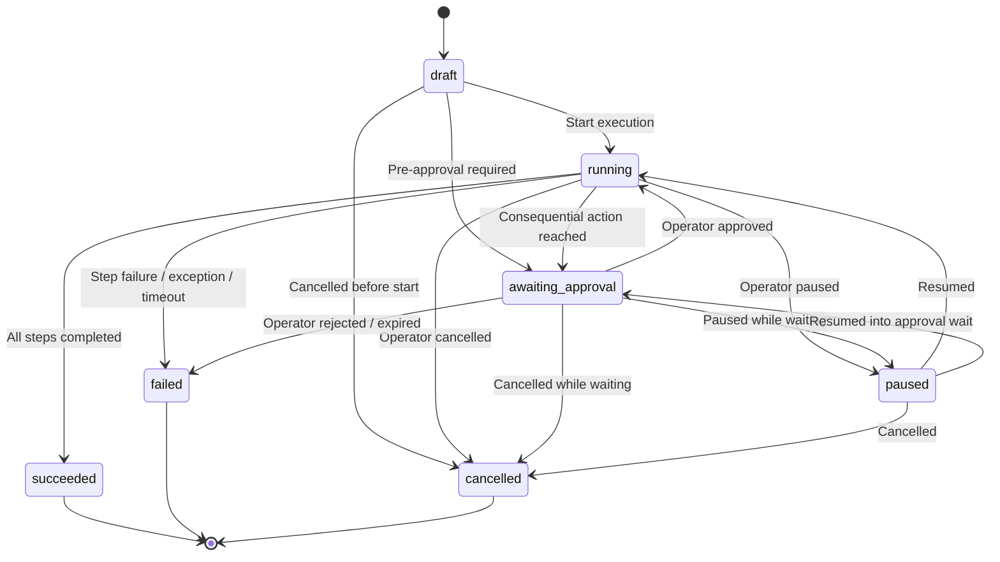

# W4 – Agentic Workflow: Architecture, Policies, Approval Management & Safe Execution (Week 2)

This directory contains the complete implementation for **Worker 4 (Agentic Workflow)** within the AcademiaAI Voicebot initiative, strictly isolated under `projects/sde-7-voicebot/`.

---

## 1. Executive Summary & Week 2 Scope

Worker 4 provides the robust, deterministic workflow execution engine for the AcademiaAI Voicebot. Building directly upon the Week 1 foundations (5 core schemas, 7-state FSM, and deterministic mock tools), Week 2 delivers:

- **Days 8–9: Dependency, Cycle, and Execution Order Validation + Allow-Listed Tool Registry**:
  - Missing dependency rejection.
  - DFS 3-color DAG cycle detection.
  - Self-dependency rejection.
  - Duplicate step ID detection.
  - Execution order validation (ensuring prerequisite steps precede dependent steps).
  - Runtime tool argument validation against `parameters_schema`.
  - Permission-scope enforcement against granted scopes.
- **Days 10–11: Approval Management (`ApprovalManager`)**:
  - Explicit approval request creation bound strictly to workflow and step IDs.
  - Lifecycle state management: `PENDING`, `APPROVED`, `REJECTED`, `EXPIRED`.
  - Expiry logic (TTL and absolute timestamps) preventing stale action execution.
  - Target step binding guarantee (approval cannot inadvertently authorize another step).
  - Safety proofs: Pending, rejected, and expired consequential actions **strictly maintain tool invocation counter = 0**.
- **Days 12–13: Safe Workflow Executor**:
  - Step execution with timeout enforcement (step-level and workflow-level).
  - Bounded retries strictly for idempotent tools (`is_idempotent=True`, capped at maximum 5 attempts).
  - Strict prohibition against automatic retries for non-idempotent operations.
  - Dynamic output propagation (`$step_id.key` or `{{step_id.key}}` resolution).
  - Safe pause, resume, and cancellation mechanics.
  - Step failure propagation (dependent steps are safely halted).
  - Comprehensive execution audit logging and state machine history.
- **Day 14: Comprehensive Policy Verification & Standalone Demonstration**:
  - 83 automated unit, policy, and security tests.
  - Standalone multi-scenario demonstration (`demo.py`) proving harmless execution, approval flow, rejection prevention, expiry, and scope enforcement.

---

## 2. Directory Structure

```text
projects/sde-7-voicebot/
├── agentic_workflow/
│   ├── __init__.py           # Package exports & public API
│   ├── schemas.py            # The 5 core schemas (defined exactly once)
│   ├── state_machine.py      # 7-state FSM with transition validation
│   ├── mock_tools.py         # Deterministic mock tools, specs, & ToolRegistry
│   ├── validator.py          # PlanValidator: DAG cycles, schemas, order, scopes
│   ├── approval_manager.py   # ApprovalManager: requests, decisions, expiry, audit
│   └── executor.py           # WorkflowExecutor: timeouts, retries, outputs, cancellation
├── tests/
│   ├── __init__.py
│   ├── test_schemas.py               # Schemas, fields, expiry, serialization
│   ├── test_state_machine.py         # Valid/illegal transitions & terminal locks
│   ├── test_mock_tools.py            # Tool specs, registry, schemas, scopes
│   ├── test_validator.py             # Plan structure, DAG cycles, execution order
│   ├── test_approval_enforcement.py  # Consequential gating & tool invocation safety proofs
│   ├── test_approval_manager.py      # ApprovalManager unit tests, TTL expiry, audit log
│   ├── test_executor.py              # End-to-end execution, pause/resume, cancel
│   └── test_policy_and_security.py   # 16 mandated policy & security compliance proofs
├── demo.py                   # Standalone multi-scenario demonstration script
└── README.md                 # Architecture, user guide, and test reports
```

---

## 3. Core Architecture & Components

### 3.1 The Five Core Schemas (`schemas.py`)
Defined exactly once in [`agentic_workflow/schemas.py`](agentic_workflow/schemas.py):

| Schema | Role | Key Attributes |
| :--- | :--- | :--- |
| **`WorkflowPlan`** | Execution plan specification | `workflow_id`, `goal`, `steps`, `state`, `timeout_seconds`, `created_at`, `metadata` |
| **`WorkflowStep`** | Atomic step contract | `step_id`, `tool_name`, `input_payload`, `dependencies`, `is_consequential`, `is_idempotent`, `retry_count`, `max_retries`, `timeout_seconds`, `status`, `result`, `metadata` |
| **`ToolSpec`** | Allow-listed tool metadata | `name`, `description`, `parameters_schema`, `is_consequential`, `required_permissions`, `is_idempotent` |
| **`ApprovalRequest`** | Human-in-the-loop gating | `request_id`, `workflow_id`, `step_id`, `tool_name`, `action_description`, `status` (`PENDING`, `APPROVED`, `REJECTED`, `EXPIRED`), `requested_at`, `decided_at`, `expires_at`, `decision_reason` |
| **`WorkflowResult`** | Outcome container | `success`, `output`, `error`, `metadata`, with `.ok()` and `.fail()` factories |

### 3.2 Finite State Machine (`state_machine.py`)
Supports 7 canonical states: `draft`, `awaiting_approval`, `running`, `paused`, `succeeded`, `failed`, `cancelled`.
Terminal states (`succeeded`, `failed`, `cancelled`) reject all subsequent transitions with `IllegalStateTransitionError`.



---

## 4. How Dependency & Order Validation Works

Implemented in [`agentic_workflow/validator.py`](agentic_workflow/validator.py):

1. **Missing Dependency Detection**:
   Verifies that every dependency listed in `step.dependencies` exists within the plan's declared step IDs. Raises `PlanValidationError` on missing references.
2. **Self-Dependency Rejection**:
   Ensures no step lists itself in its dependencies (`step_id in step.dependencies`).
3. **Circular Dependency Detection (DAG Cycles)**:
   Performs Depth-First Search (DFS) with 3-color node classification:
   - `WHITE (0)`: Unvisited node.
   - `GRAY (1)`: Node on the active recursion stack.
   - `BLACK (2)`: Fully explored node.
   Any back-edge pointing to a `GRAY` node identifies a circular dependency, raising a descriptive error with the full cycle path:
   `Circular dependency detected in plan: step_a -> step_b -> step_a.`
4. **Execution Order Validation**:
   Verifies that for every step in `plan.steps`, all prerequisite dependencies appear at an earlier index in the step list. Forward dependencies raise an `Execution order violation`.
5. **Topological Order Resolution**:
   Provides `validator.get_topological_order(plan)` to compute valid execution sequences using Kahn's algorithm.

---

## 5. How Tool Registration & Scope Enforcement Works

Implemented in [`agentic_workflow/mock_tools.py`](agentic_workflow/mock_tools.py):

### Registered Tools
1. **`academic_lookup`**:
   - `is_consequential = False` (harmless read-only query).
   - `is_idempotent = True` (safe to retry on transient failure).
   - `required_permissions = ["academic:read"]`.
   - Payload: `record_type` (`"student"` or `"course"`), `record_id` (`str`).
2. **`student_status_update`**:
   - `is_consequential = True` (mutation requiring explicit operator approval).
   - `is_idempotent = False` (mutation; automatic retries strictly forbidden).
   - `required_permissions = ["academic:write"]`.
   - Payload: `student_id` (`str`), `new_status` (`"active"`, `"on_leave"`, `"probation"`, `"graduated"`), `reason` (`str`).

### ToolRegistry Guarantees
- **Allow-Listing**: Only tools registered via `registry.register(spec, handler)` can be executed. Unregistered tools fail immediately.
- **Runtime Argument Conformance**: `registry.validate_payload(name, payload)` verifies parameter presence, types (`str`, `int`, `float`, `bool`, `list`, `dict`), and enum constraints before invoking the handler.
- **Permission-Scope Enforcement**: `registry.check_permissions(name, granted_permissions)` compares `tool.required_permissions` with caller scopes. Unauthorized invocations fail immediately without executing the tool handler.
- **Invocation Counter Auditing**: `registry.get_invocation_count(name)` increments **strictly upon genuine handler invocation**, providing mathematical proof of non-execution.

---

## 6. How Approval, Rejection & Expiry Work

Implemented in [`agentic_workflow/approval_manager.py`](agentic_workflow/approval_manager.py):

### 1. Request Creation
When the executor reaches a consequential step (`is_consequential=True`), it requests authorization:
- Creates an `ApprovalRequest` with unique ID `apr-{workflow_id}-{step_id}`.
- Sets status to `PENDING`.
- Computes `expires_at` based on step metadata or manager TTL.
- Halts execution and transitions workflow state to `awaiting_approval`.
- **The tool handler is NOT invoked (counter = 0)**.

### 2. Approval Flow
- Operator invokes `executor.submit_approval(step_id, approved=True, reason=...)`.
- Request status transitions to `APPROVED`, setting `decided_at` and `decision_reason`.
- An immutable `ApprovalAuditEntry` is appended to the audit log.
- On `executor.run()`, the workflow transitions from `awaiting_approval` to `running`, executing the tool handler.

### 3. Rejection Flow
- Operator invokes `executor.submit_approval(step_id, approved=False, reason=...)`.
- Request status transitions to `REJECTED`.
- On `executor.run()`, the step fails, and the workflow transitions to `failed`.
- **CRITICAL SAFETY PROOF**: Tool invocation counter strictly remains `0`.

### 4. Expiry Flow
- If current UTC time exceeds `expires_at`, `check_expiry()` marks the request as `EXPIRED`.
- The executor halts, transitions the workflow to `failed`, and logs the expiry event.
- **CRITICAL SAFETY PROOF**: Expired requests are never approved or executed; tool invocation count strictly remains `0`.

### 5. Target Step Binding
- Approval for `step_a` cannot be reused for or applied to `step_b`. Each approval request is permanently bound to its designated `workflow_id` and `step_id`.

---

## 7. How Timeouts, Retries, Cancellation & Output Propagation Work

Implemented in [`agentic_workflow/executor.py`](agentic_workflow/executor.py):

### 1. Execution Timeouts
- **Workflow-Level Timeout**: Monitored via monotonic clock (`time.monotonic()`). If cumulative execution exceeds `workflow_timeout_seconds`, execution terminates in `failed` state with timeout metadata.
- **Step-Level Timeout**: Individual steps specify `timeout_seconds`. Executed via a bounded thread worker; if execution duration exceeds the limit, the future times out and returns `WorkflowResult.fail(..., metadata={"timeout": True})`.

### 2. Bounded Retries
- Retries are permitted **ONLY if `is_idempotent=True`**.
- Read-only tools like `academic_lookup` are retried up to `min(step.max_retries, 5)`.
- If an idempotent operation fails with a transient error, the executor logs a retry event and re-attempts execution.
- **Non-Idempotent Protection**: Mutations like `student_status_update` (`is_idempotent=False`) **NEVER retry automatically** (`retry_count == 0`), eliminating duplicate mutation risks.

### 3. Workflow Cancellation
- Calling `executor.cancel(reason=...)` immediately transitions the workflow to `cancelled`.
- Unexecuted steps are marked `cancelled`.
- No further tool handlers are invoked.

### 4. Step Output Propagation
- Steps dynamically reference outputs from prerequisite completed steps using:
  - Dotted path: `"$step_student.enrolled_courses[0]"` or `"$step_student.output.student_id"`.
  - Mustache syntax: `"{{step_student.student_id}}"`.
- Before executing a step, the executor resolves all dynamic references against prior completed step outputs.

### 5. Failure Propagation
- If a prerequisite step fails or times out, downstream dependent steps remain unexecuted (`pending`), preventing cascading failures.

---

## 8. How to Run the Tests

The entire test suite runs via standard `pytest` or `unittest`:

```bash
# From the W4 workspace directory:
python -m pytest projects/sde-7-voicebot/tests -v

# Or using standard unittest discovery:
python -m unittest discover -s projects/sde-7-voicebot/tests -v
```

### Complete Test Results

```text
============================= test session starts =============================
platform win32 -- Python 3.11.9, pytest-8.3.4, pluggy-1.6.0
collected 83 items

projects/sde-7-voicebot/tests/test_approval_enforcement.py (6 tests)       PASSED
projects/sde-7-voicebot/tests/test_approval_manager.py (9 tests)           PASSED
projects/sde-7-voicebot/tests/test_executor.py (4 tests)                   PASSED
projects/sde-7-voicebot/tests/test_mock_tools.py (14 tests)                 PASSED
projects/sde-7-voicebot/tests/test_policy_and_security.py (17 tests)       PASSED
projects/sde-7-voicebot/tests/test_schemas.py (9 tests)                    PASSED
projects/sde-7-voicebot/tests/test_state_machine.py (10 tests)             PASSED
projects/sde-7-voicebot/tests/test_validator.py (14 tests)                 PASSED

============================= 83 passed in 0.32s ==============================
```

All **83 tests pass cleanly in 0.32 seconds** with zero failures, errors, or warnings.

---

## 9. How to Run the Demonstrations

Execute the standalone demonstration script:

```bash
python projects/sde-7-voicebot/demo.py
```

### Scenarios Demonstrated:

1. **DEMO A: Harmless Read-Only Workflow Executes Successfully**:
   - Queries student record `S101`.
   - Propagates first enrolled course (`CS101`) dynamically into next step (`$step_student.enrolled_courses[0]`).
   - Transitions cleanly: `draft` -> `running` -> `succeeded`.
2. **DEMO B: Consequential Action Requests Approval, Receives Approval, and Executes**:
   - Reaches consequential status update for `S102`.
   - Halts at `awaiting_approval` with invocation counter = 0.
   - Operator grants explicit approval with reason.
   - Resumes to `succeeded` and invokes tool handler exactly once.
3. **DEMO C: Consequential Action is Rejected and Tool Invocation Count Strictly Remains ZERO**:
   - Attempts unauthorized probation placement.
   - Halts at `awaiting_approval` with invocation counter = 0.
   - Operator rejects request with reason.
   - Workflow terminates in `failed` state.
   - **SAFETY PROOF**: `student_status_update` invocation counter strictly remains `0`.
4. **DEMO D: Advanced Policy Controls**:
   - Proves approval request with expired TTL fails without invoking tool.
   - Proves read-only caller attempting write action triggers permission-scope violation.

---

## 10. Acceptance Criteria Checklist

| Requirement | Implementation | Status |
| :--- | :--- | :---: |
| Dependency & DAG Cycle Validation | Missing deps, self-deps, duplicate IDs, and DFS DAG cycle detection in `PlanValidator` | **COMPLETE** |
| Execution Order Validation | `_validate_execution_order` enforces prerequisite ordering | **COMPLETE** |
| Allow-Listed Tool Registry | `ToolRegistry` enforces allow-list, schemas, and tracks invocations | **COMPLETE** |
| Tool Argument Schema Validation | Type checking (`str`, `int`, `float`, `bool`, `list`, `dict`) and enum allowed values | **COMPLETE** |
| Permission-Scope Enforcement | `ToolSpec.required_permissions` verified against authorized caller scopes | **COMPLETE** |
| Approval Management | `ApprovalManager` with `PENDING`, `APPROVED`, `REJECTED`, `EXPIRED` lifecycle | **COMPLETE** |
| Approval Expiry Handling | TTL and timestamp expiry validation preventing stale actions | **COMPLETE** |
| Target Step Binding | Approvals apply strictly to their intended workflow and step | **COMPLETE** |
| Zero Invocation Proof on Rejection/Expiry | Pending, rejected, and expired consequential actions never execute tools (count = 0) | **COMPLETE** |
| Execution Timeouts | Monotonic workflow timeouts and step-level thread timeout controls | **COMPLETE** |
| Bounded Retries for Idempotent Tools | Retries strictly bounded and permitted only when `is_idempotent=True` | **COMPLETE** |
| No Retries for Non-Idempotent Tools | Mutation tools (`is_idempotent=False`) strictly prohibited from automatic retry | **COMPLETE** |
| Workflow Cancellation | `cancel()` halts execution, locks state in `CANCELLED`, cancels pending steps | **COMPLETE** |
| Output Propagation | Resolves dynamic `$step_id.key` expressions from prior completed step outputs | **COMPLETE** |
| Failure Propagation | Failed step prevents execution of downstream dependent steps | **COMPLETE** |
| Execution & Audit History | Transition history, approval audit log, and executor event trail captured | **COMPLETE** |
| Comprehensive Policy Tests | 83 tests passing with 100% success rate across all modules | **COMPLETE** |
| Standalone Demonstrations | Demos A, B, C, and D verified and functional | **COMPLETE** |
| Backward Compatibility | All Week 1 interfaces and contracts 100% preserved | **COMPLETE** |
