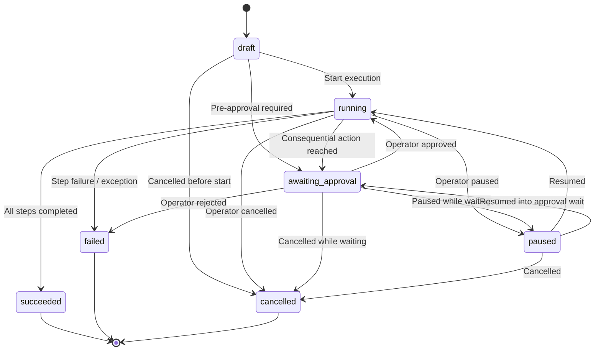

# W4 – Agentic Workflow: Workflow Schemas, State Machine & Mock Tool Executor (Week 1)

This project contains the official Week 1 foundation for **Worker 4 (Agentic Workflow)** within the AcademiaAI Voicebot initiative, strictly isolated under `projects/sde-7-voicebot/`.

---

## 1. Repository Scope & Inspection Report

- **Target Repository**: [https://github.com/Yashuudevang/acd_voicebot](https://github.com/Yashuudevang/acd_voicebot)
- **Local Isolated Scope**: `projects/sde-7-voicebot/`
- **Inspection Findings**:
  - The upstream repository currently contains only the default `main` branch with a root `README.md`.
  - The target path `projects/sde-7-voicebot/` and team branches do not yet exist upstream.
  - Per engineering instructions, no competing repository was created, no shared files outside our scope were modified, and no Git push or branch alterations were made.
  - All Week 1 deliverables are implemented strictly within `projects/sde-7-voicebot/`.

---

## 2. Directory Structure

```text
projects/sde-7-voicebot/
├── agentic_workflow/
│   ├── __init__.py           # Package exports & public API
│   ├── schemas.py            # The 5 core schemas (defined exactly once)
│   ├── state_machine.py      # 7-state FSM with transition validation
│   ├── mock_tools.py         # Exactly 2 harmless mock tools & ToolRegistry
│   ├── validator.py          # PlanValidator with DAG cycle detection
│   └── executor.py           # WorkflowExecutor with approval enforcement
├── tests/
│   ├── __init__.py
│   ├── test_schemas.py               # Schemas & serialization tests
│   ├── test_state_machine.py         # Valid/illegal transitions & terminal locks
│   ├── test_mock_tools.py            # Mock tool behavior & registry tests
│   ├── test_validator.py             # Plan validation & DAG cycle tests
│   ├── test_approval_enforcement.py  # Consequential gating & tool invocation safety proofs
│   └── test_executor.py              # End-to-end execution, pause/resume, cancel
├── demo.py                   # Standalone demonstration script
└── README.md                 # Complete documentation & test report
```

---

## 3. The Five Core Schemas

Defined exactly once in [`agentic_workflow/schemas.py`](agentic_workflow/schemas.py):

| Schema | Role | Key Attributes |
| :--- | :--- | :--- |
| **`WorkflowPlan`** | Top-level execution plan | `workflow_id`, `goal`, `steps`, `state`, `created_at`, `metadata` |
| **`WorkflowStep`** | Atomic execution step | `step_id`, `tool_name`, `input_payload`, `dependencies`, `is_consequential`, `status`, `result`, `metadata` |
| **`ToolSpec`** | Allow-listed tool specification | `name`, `description`, `parameters_schema`, `is_consequential` |
| **`ApprovalRequest`** | Human-in-the-loop approval gating contract | `request_id`, `workflow_id`, `step_id`, `tool_name`, `action_description`, `status` (`PENDING`, `APPROVED`, `REJECTED`), `requested_at`, `decided_at`, `decision_reason` |
| **`WorkflowResult`** | Standardized outcome container | `success`, `output`, `error`, `metadata`, with `.ok()` and `.fail()` factories |

All five schemas support round-trip serialization via `.to_dict()` and `.from_dict()`.

---

## 4. Finite State Machine & Valid Transitions

Implemented in [`agentic_workflow/state_machine.py`](agentic_workflow/state_machine.py), supporting all 7 required states:
1. `draft` (initial state)
2. `awaiting_approval` (paused awaiting human/voice confirmation)
3. `running` (actively executing steps)
4. `paused` (temporarily suspended by operator)
5. `succeeded` (terminal success)
6. `failed` (terminal failure or rejection)
7. `cancelled` (terminal cancellation)

### Valid Transition Matrix

```text
Current State       Allowed Next States
-------------       -------------------
draft               running, awaiting_approval, cancelled
running             awaiting_approval, paused, succeeded, failed, cancelled
awaiting_approval   running (approved), paused, failed (rejected), cancelled
paused              running (resumed), awaiting_approval, cancelled
succeeded           [TERMINAL - No transitions permitted]
failed              [TERMINAL - No transitions permitted]
cancelled           [TERMINAL - No transitions permitted]
```

### Transition Diagram



Attempting any transition not listed above (or attempting to transition out of terminal states) raises `IllegalStateTransitionError`.

---

## 5. Exactly Two Harmless Deterministic Mock Tools

Implemented in [`agentic_workflow/mock_tools.py`](agentic_workflow/mock_tools.py):

### 1. `academic_lookup`
- **Classification**: Read-Only / Non-Consequential (`is_consequential=False`).
- **Description**: Deterministically look up student records (`S101`, `S102`, `S103`) or course catalog details (`CS101`, `AI202`, `ENG301`).
- **Inputs**: `record_type` (`"student"` or `"course"`), `record_id` (`str`).
- **Safety**: 100% in-memory deterministic lookup, no external calls.

### 2. `student_status_update`
- **Classification**: Consequential (`is_consequential=True`).
- **Description**: Deterministically updates student enrollment status in the in-memory store.
- **Inputs**: `student_id` (`str`), `new_status` (`"active"`, `"on_leave"`, `"probation"`, `"graduated"`), `reason` (`str`).
- **Safety**: 100% in-memory mock update (harmless mock, no database or external mutation). Classified as consequential to enforce human approval gating.

### Tool Registry (`ToolRegistry`)
- Maintains strict allow-listing: unregistered tool calls are rejected.
- Validates parameter presence, types, and allowed values.
- Encapsulates exceptions into safe `WorkflowResult.fail()` outcomes.
- Tracks tool invocation counts for verification and test auditing.

---

## 6. Consequential Action Gating & Safety Proofs

1. **Default to `awaiting_approval`**:
   - Any step invoking a consequential tool (or explicitly flagged `is_consequential=True`) defaults to `awaiting_approval` unless explicit prior approval exists.
2. **Tool Invocation Guarantee (Safety Proof 1 - Pending)**:
   - When a consequential action is reached, execution immediately halts, transitioning to `awaiting_approval`.
   - **The tool handler is NEVER invoked while approval is pending** (invocation counter strictly remains `0`).
3. **Rejection Guarantee (Safety Proof 2 - Rejection)**:
   - If the operator or policy rejects the approval request, the workflow transitions from `awaiting_approval` to `failed`.
   - **The tool handler is NEVER invoked upon rejection** (invocation counter strictly remains `0`).
4. **Approved Execution**:
   - Only when explicit approval is granted does the state machine transition to `running`, invoking the tool handler exactly once.

---

## 7. How to Run the Tests

The entire test suite relies only on Python standard library (`unittest`):

```bash
# From within projects/sde-7-voicebot:
python -m unittest discover -s tests -v

# Or from the repository root:
python -m unittest discover -s projects/sde-7-voicebot/tests -v
```

### Actual Test Results

```text
Ran 52 tests in 0.006s

OK
```

All 52 tests pass in 6 milliseconds across all test modules:
- `test_schemas.py`: 6 tests (schemas, helpers, serialization)
- `test_state_machine.py`: 10 tests (7 states, valid transitions, illegal transition errors, terminal locks, history)
- `test_mock_tools.py`: 14 tests (tool specs, lookup behaviors, updates, registry isolation, invocation counts)
- `test_validator.py`: 13 tests (structure, duplicates, unregistered tools, schemas, dependencies, cycles)
- `test_approval_enforcement.py`: 5 tests (approval defaults, pending tool call prevention proof, rejection prevention proof, approval flow, non-consequential bypass)
- `test_executor.py`: 4 tests (multi-step workflow, pause/resume, cancel, step failure propagation)

---

## 8. Standalone Demonstration

Run the demonstration script to verify harmless mock execution and approval flows:

```bash
python projects/sde-7-voicebot/demo.py
```

### Demonstration Scenarios Demonstrated

1. **Scenario 1: Harmless Read-Only Workflow**:
   - Executes multi-step `academic_lookup` for student and course details.
   - Transitions cleanly: `draft` -> `running` -> `succeeded`.
2. **Scenario 2: Consequential Approval Flow**:
   - Halts at `awaiting_approval` for `student_status_update` (invocation count: 0).
   - Generates `ApprovalRequest`.
   - Operator grants approval.
   - Resumes to `succeeded` (invocation count: 1).
3. **Scenario 3: Consequential Rejection Flow**:
   - Halts at `awaiting_approval` (invocation count: 0).
   - Operator rejects the request.
   - Workflow terminates in `failed` state.
   - Verifies tool invocation count strictly remains 0.

---

## 9. Intentionally Deferred Items & Future Integration

- **Speech-to-Text (Worker 1)**: Voice approval confirmation and voice plan transcription will wire into `ApprovalRequest` and `WorkflowPlan.from_dict()`.
- **Reasoning/Planner (Worker 2)**: Dynamic LLM plan generation will output structured `WorkflowPlan` data.
- **Backend/Sessions (Worker 3)**: Session storage and event pub/sub will consume `WorkflowStateMachine.history` and `WorkflowResult.to_dict()`.
- **Frontend/UX (Worker 5)**: Progress modals and approval prompts will listen for `awaiting_approval` state and submit decisions via `WorkflowExecutor.submit_approval()`.
